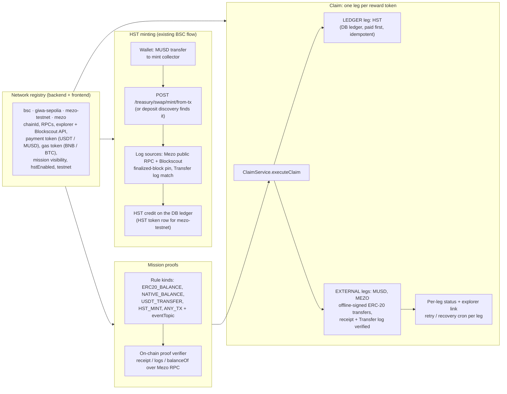

# HodlerStation × Mezo

**HodlerStation** is a live mission-and-rewards platform at **https://app.hodlerstation.xyz**. Creators publish missions, participants prove actions (on-chain or social), and rewards are held in escrow and paid out automatically. **HST** (HodlerStation Token) is the platform reward credit, minted 1:1 against a stable payment token (USDT on BSC until now).

For the Mezo Buildathon we added **Mezo as a full network of the existing product**. We did not build a separate campaign app. The same mint, mission, escrow and claim code now runs on Mezo, with Mezo-specific branches where the chain differs:

- **Mezo Testnet / Mezo Mainnet in the network switch.** When a Mezo network is selected, the app shows Mezo missions only, and Mezo missions are hidden on every other network.
- **MUSD → HST minting.** The user sends MUSD to the mint collector and the server checks the Transfer log on Mezo, then credits HST. This is the BSC USDT mint flow with a different network entry.
- **Mezo on-chain missions** checked against the Mezo RPC:
  - **A** hold MUSD (`ERC20_BALANCE`)
  - **B** send an exact MUSD amount to an address (`USDT_TRANSFER`)
  - **C** mint HST with an exact MUSD payment (`HST_MINT`)
  - **D** hold MEZO (`ERC20_BALANCE` on the MEZO token)
  - **E** call a contract and emit a specific event (`ANY_TX` + `eventTopic`)
- **MEZO / MUSD / HST rewards**, alone or combined in one mission (for example *0.1 MUSD + 0.01 MEZO + 0.15 HST*). Each token is a separate payout **leg** with its own status and explorer link. A failed leg is retried by itself and never blocks the legs that were already paid.

> **Status:** Testnet only. Everything below was exercised end-to-end against the **public Mezo Testnet (31611)** from a local full stack (production code, isolated database). Mezo Mainnet (31612) is registered for network switching, holding missions and MUSD/MEZO rewards. On mainnet, HST minting is disabled on purpose because it would involve real assets.

## Contents

| Path | What it is |
|---|---|
| [`docs/architecture.md`](docs/architecture.md) | How the integration reuses the existing system, and where Mezo needed its own branch |
| [`docs/demo-script.md`](docs/demo-script.md) | Scene list for the demo video |
| [`docs/testing-evidence.md`](docs/testing-evidence.md) | Local E2E against the public testnet: mission types A–E, combined rewards, recovery, guard cases |
| [`contracts/`](contracts/) | `HstToken` / `HstTreasury` Solidity sources, Foundry config, deploy script and tests (MIT) |
| [`scripts/deploy-hst.sh`](scripts/deploy-hst.sh) | Mezo Testnet deploy script. The key is read from a file you supply and none is stored here |
| [`integration/`](integration/) | Unmodified excerpts from the private backend and frontend at the Mezo branching points |
| [`modules/mezo-chain.mjs`](modules/mezo-chain.mjs) | Mezo chain constants (31611 / 31612, MUSD, MEZO, HodlerStation contracts) |
| [`tools/check-network.mjs`](tools/check-network.mjs) | Read-only check of the RPCs, token contracts and HodlerStation contracts on both networks |
| [`submission/`](submission/) | Logo and screenshots |

## Architecture: reuse by branching

Every hard-coded network list in the codebase (mint DTOs, wallet kinds, mission filters, cache keys, chainId lookups) now reads the registry. Mezo is therefore mostly **new data**, plus a few explicit branches:

| Branch | Why Mezo needed it |
|---|---|
| `missionVisibility: 'exclusive'` | Mezo missions appear only when a Mezo network is selected |
| `ERC20_BALANCE` / `NATIVE_BALANCE` rules | "Hold MUSD / MEZO / BTC" missions are approved without a transaction hash. The proof key is `balance:<mission>:<wallet>`, so a second account cannot reuse the same wallet |
| `ANY_TX.eventTopic` | Lets a mission require a specific contract event (for example an `Approval` on MUSD) |
| Reward legs (`externalRewards[]`) | One mission pays MUSD and MEZO as two ERC-20 transfers, plus an HST ledger leg |
| Blockscout API host ≠ explorer UI host | `explorerApiUrl` in the registry |
| Finality pin for Blockscout eth-rpc | Mezo's Blockscout rejects block tags in the same way as GIWA's. The `finalized` tag is taken from the RPC operator group |
| Real-asset guard | Mezo Mainnet has `hstEnabled: false`, and `USDT_TRANSFER` / `HST_MINT` rules are testnet-only |

More detail is in [`docs/architecture.md`](docs/architecture.md).

## How MUSD and MEZO are used

- **MUSD** (Mezo's BTC-backed stablecoin, 18 decimals) is the **payment token**. Users mint HST with it at 1 HST = 1 MUSD, minus a 0.1% service fee. MUSD is also a **mission target** (hold it, or send an exact amount) and a **reward asset**.
- **MEZO** is a **mission target** (hold ≥ X) and a **reward asset**.
- **BTC** is the gas token. Reward payouts budget their gas from the payout wallet's native BTC balance, and `NATIVE_BALANCE` missions can require holding BTC.

| Token | Mezo Testnet (31611) | Mezo Mainnet (31612) |
|---|---|---|
| MUSD | [`0x118917a40FAF1CD7a13dB0Ef56C86De7973Ac503`](https://explorer.test.mezo.org/address/0x118917a40FAF1CD7a13dB0Ef56C86De7973Ac503) | [`0xdD468A1DDc392dcdbEf6db6e34E89AA338F9F186`](https://explorer.mezo.org/address/0xdD468A1DDc392dcdbEf6db6e34E89AA338F9F186) |
| MEZO | [`0x7B7c000000000000000000000000000000000001`](https://explorer.test.mezo.org/address/0x7B7c000000000000000000000000000000000001) | `0x7B7c000000000000000000000000000000000001` |

## Contracts on Mezo Testnet

| Contract | Address | Deploy tx |
|---|---|---|
| `HstToken` | [`0x4436c6622741579A08a79382281dE47e8264df77`](https://explorer.test.mezo.org/address/0x4436c6622741579A08a79382281dE47e8264df77) | [`0x0ad22729…74a90`](https://explorer.test.mezo.org/tx/0x0ad22729b1c33ce725a8fab006a8fc46cf8376c344893275007f0afc06874a90) |
| `HstTreasury` (MUSD collateral) | [`0x7167F3a503b3087905a1b02d11c08f4e7D0a15C2`](https://explorer.test.mezo.org/address/0x7167F3a503b3087905a1b02d11c08f4e7D0a15C2) | [`0xdf80beff…152e2`](https://explorer.test.mezo.org/tx/0xdf80beff6e74ca15c3fb6f8fbe968fc3c6a94c5c5621217a32a5192de48152e2) |

Both were deployed on 2026-10-23 at block 16323761. They are the defaults of `HST_CONTRACTS['mezo-testnet']` in the backend ([excerpt](integration/backend/hst-ledger/hst-contracts.mezo.ts)).

**What the contracts do today:** they are deployed but **not used for minting by default**. The production HST ledger on Mezo Testnet is the **DB ledger**, the same as on BSC. A MUSD mint credits HST in the database inside the mint transaction, and the claim pays the HST leg from the same ledger. The contract ledger can be switched on per network: set `HST_ONCHAIN_NETWORKS=mezo-testnet`, register an operator wallet for chain 31611, and restart. After that, minting and HST rewards go through `HstTreasury` / `HstToken`. The source is **not verified on the Mezo explorer yet**. The Solidity in [`contracts/`](contracts/) is the source that was deployed. `forge test` passes 30/30 locally.

## Verified testnet transactions

Every hash below was checked on 2026-10-26: the receipt has `status = 1` on `rpc.test.mezo.org`, and the explorer API reports `success`. Token amounts come from the Transfer logs in each receipt. Test wallets: `0x40D8…Fe70` (user 1), `0x7701…c192` (user 2), `0x045c…26b6` (user 3), `0xaf19…c06c` (partner / creator test wallet), `0x6423…d564` (platform mint collector and reward payout wallet on Mezo Testnet).

| What | Tx | Transfer |
|---|---|---|
| **Mint**: MUSD → HST (`from-tx`, 9.99 HST credited after the 0.1% fee) | [`0x34f96e7e…65a06`](https://explorer.test.mezo.org/tx/0x34f96e7e5917a7c5d4ad4d11c750d5a6e4950458e6a1a3ff532b708a67565a06) | 10 MUSD user 1 → collector |
| **Mint** picked up by deposit discovery | [`0x4c8ec0d6…02146`](https://explorer.test.mezo.org/tx/0x4c8ec0d61c8410255ff2ead89b2504f10ec39b2ed349b6047eab9b4c78402146) | 2 MUSD user 1 → collector |
| **Mission C mint** (demo: Mint page → back to the mission with the hash) | [`0x3ad4634a…a1bd3`](https://explorer.test.mezo.org/tx/0x3ad4634ae147c16c0b7cb20d7ed976b11ccd7a61e99bae8b75ca45afb40a1bd3) | 2 MUSD user 1 → collector |
| ↳ reward leg MUSD | [`0x59311bda…47fcb`](https://explorer.test.mezo.org/tx/0x59311bdae3fed86d2e3f4dc54fad24cee21b50b6e612c663fa69bd0278947fcb) | 0.1 MUSD → user 1 |
| ↳ reward leg MEZO | [`0x38c91b14…541bc`](https://explorer.test.mezo.org/tx/0x38c91b14e1e98665f0c62583c2a5f2f0e719274e6b53f7a522edef068f4541bc) | 0.01 MEZO → user 1 |
| ↳ reward leg HST | DB ledger (no chain tx) | 0.15 HST, shown as *Paid* |
| Same mission, second participant: mint | [`0x8ee0469f…3b24c`](https://explorer.test.mezo.org/tx/0x8ee0469f2f5b6f217c6866ff83f9f2b050298a0e460bb2a158999d644d93b24c) | 2 MUSD user 2 → collector |
| ↳ MUSD / MEZO legs | [`0x5c8c9f9c…e3970`](https://explorer.test.mezo.org/tx/0x5c8c9f9cf3d726d305251679e4c5089a38d4cffdc6e37fb542bf6e424ede3970) · [`0x919cbdab…a186e`](https://explorer.test.mezo.org/tx/0x919cbdab9ccc21409c4c8fc9d4f82abbba4305175130c6d138b329164a4a186e) | 0.1 MUSD · 0.01 MEZO → user 2 |
| **Mission A** (hold ≥ 1 MUSD) payout | [`0x22e22b04…c566f`](https://explorer.test.mezo.org/tx/0x22e22b04b1f07fb983ca43fd82339f94d869cc8dda1f7ddea0f7adb5e52c566f) | 1 MUSD → user 1 |
| **Mission B** (send exactly 0.5 MUSD to the partner): proof | [`0xe6e4c1c8…e257a`](https://explorer.test.mezo.org/tx/0xe6e4c1c83984ad10092b1cbe4b2a7260e372f35078d7e710699b7c48a6ee257a) | 0.5 MUSD user 1 → partner |
| ↳ payout | [`0x88417848…137aa`](https://explorer.test.mezo.org/tx/0x88417848346618c9c37d2b50cfdf3ee7398eb3ce41ac28b7cf4a408382c137aa) | 0.5 MUSD → user 1 |
| **Mission C** (mint HST with exactly 2 MUSD): proof | [`0xdef2394b…1e054`](https://explorer.test.mezo.org/tx/0xdef2394ba54e80f89f3d0f25fc7855ead171fcb9a2330f70e4984a5176c1e054) | 2 MUSD user 1 → collector |
| ↳ payout | [`0x56626296…10c10`](https://explorer.test.mezo.org/tx/0x5662629656bf90ef9f289bfe482eb1f9976a3302db8dc4ecdb7a2759df610c10) | 0.5 MUSD → user 1 |
| **Mission D** (hold ≥ 1 MEZO) payout | [`0x48a0e2c7…ca24f`](https://explorer.test.mezo.org/tx/0x48a0e2c7dd8f93fb546c7b1a97ae4b13b1ae58f961c68f011c3082c340fca24f) | 0.5 MUSD → user 1 |
| **Mission E** (MUSD `Approval` event): proof | [`0x440a6008…0b604`](https://explorer.test.mezo.org/tx/0x440a6008f934f9d1cff06671f97d6680c708bced0272d65e8d4eda0b3be0b604) | `approve` (Approval log) |
| ↳ payout | [`0x742d33cc…35016`](https://explorer.test.mezo.org/tx/0x742d33cc640912196a641935d39d00d75de4a84dbd1b966f73165907e6335016) | 0.5 MUSD → user 1 |
| **Recovery**: three-leg mission (MUSD + MEZO + HST). The first claim left both EVM legs unsent, and the recovery job sent them later | [`0xee843835…b28b7`](https://explorer.test.mezo.org/tx/0xee843835797af409bc56e888659750fe65f06ef995430b5255bcdbcd900b28b7) · [`0x210895fd…fb97c`](https://explorer.test.mezo.org/tx/0x210895fdef6254fb7a2487410b0bc71e9aa6b08cf531b97699b859bbaeffb97c) | 0.5 MUSD · 0.1 MEZO → user 1 |
| **Recovery**: claim completed after the participant relinked their wallet | [`0x4a342c61…7d68e`](https://explorer.test.mezo.org/tx/0x4a342c615f6ec159326a8067849b3c84e6929ca2727adcb88aff2c048467d68e) · [`0xc78f7342…477b4`](https://explorer.test.mezo.org/tx/0xc78f734289cb0af671c48001b02651feded9daf9e9aaf54cfc72084091c477b4) | 0.1 MUSD · 0.01 MEZO → user 3 |

Guard cases (invalid rules refused at creation, a claim without a linked wallet refused before any HST moves, a mint that was already credited or is still confirming) are listed in [`docs/testing-evidence.md`](docs/testing-evidence.md).

## Try it

1. Open **https://app.hodlerstation.xyz**, sign in, and switch the header network chip to **Mezo Testnet**. Only Mezo missions are shown from then on.
2. Get test **BTC** (gas) and **MEZO** from https://faucet.test.mezo.org. Borrow test **MUSD** against BTC in the Mezo testnet app at https://testnet.mezo.org/.
3. **Mint:** go to *HST Mint* and enter a MUSD amount. The wallet sends MUSD to the collector shown on the page, and HST appears in the header after the transfer is confirmed. Both the hash and deposit discovery are accepted.
4. **Missions:** open a Mezo mission and complete the on-chain task (hold, transfer, mint or contract event). The proof is checked on Mezo and approved immediately. Claim to receive each reward leg (MUSD / MEZO / HST), each with its own status and explorer link.
5. Optional, from this repo: `node tools/check-network.mjs` checks the RPCs and contracts read-only.

**Demo:** the recorded walkthrough is attached to the Mezo Buildathon submission; the scene list and screenshots are in [`docs/demo-script.md`](docs/demo-script.md) and [`submission/screenshots/`](submission/screenshots/).

## Limitations and roadmap

- **Contract source not verified** on the Mezo explorer yet. The deploy script requests Blockscout verification, but it did not complete for this deployment.
- **The HST contract ledger is off by default.** Mezo Testnet HST runs on the DB ledger like BSC. Turning on `HstToken` / `HstTreasury` is a configuration switch that has been tested in code but is not enabled in production.
- **MUSD / MEZO reward pools are platform-funded for now.** Missions with external MUSD/MEZO legs are created by platform admins and paid from the platform reward wallet. **Creator-funded EVM reward pools** (a creator deposits MUSD/MEZO for their own mission) are in progress.
- **Mezo Mainnet:** network switch, holding / any-tx / incoming-tx missions and MUSD/MEZO rewards only. No HST minting and no transfer-to-address or mint rules, because these would involve real assets.
- SBT rewards attached to a Mezo testnet mission are minted on GIWA (HodlerStation's SBT chain). Points and SBT contracts are not deployed on Mezo.
- `INCOMING_TX` missions on Mezo rely on the Blockscout `txlist` API.

## 한국어 요약

HodlerStation(https://app.hodlerstation.xyz)은 미션을 수행하면 토큰 보상을 받는 서비스입니다. 이번 빌더톤에서 Mezo를 기존 서비스에 네트워크로 붙였습니다. 새 앱을 따로 만들지 않고 네트워크 레지스트리에서 분기했습니다.

- MUSD로 HST를 민팅합니다. 기존 BSC USDT 민팅 흐름을 그대로 씁니다.
- Mezo 온체인 미션 다섯 가지를 지원합니다: MUSD 보유, MUSD 전송, HST 민팅, MEZO 보유, 컨트랙트 이벤트.
- 보상은 MEZO, MUSD, HST를 하나만 걸거나 묶어서 걸 수 있습니다. 토큰마다 지급 상태와 탐색기 링크를 따로 보여 줍니다.
- 네트워크를 Mezo로 고르면 화면에 Mezo 내용만 보입니다.

HstToken과 HstTreasury는 테스트넷에 배포했지만 기본 원장은 BSC처럼 DB 원장입니다. 설정을 켜면 컨트랙트 원장으로 바꿀 수 있습니다. 컨트랙트 소스는 아직 탐색기에서 검증(verify)하지 않았습니다. 위 트랜잭션은 모두 Mezo 테스트넷에서 성공(status 1)을 확인했습니다.

## License

[MIT](LICENSE) covers the HodlerStation-authored source in this repository, including `contracts/` and the excerpts in `integration/`. The rest of the private product repositories is not covered by this license.
